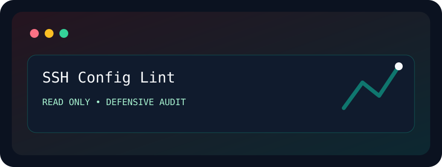

<div align="center">


[](LICENSE)
[](https://www.python.org/)
[](https://github.com/CyberLoop-dev/ssh-config-lint/stargazers)
[](https://github.com/CyberLoop-dev/ssh-config-lint/commits/main)

**Find risky SSH client settings before they surprise you.**



</div>

## 🧭 Overview

SSH Config Lint reads an OpenSSH client config and reports duplicate aliases plus a small set of risky options. It does not connect to hosts, change configuration, or read private-key contents.

## ✨ Features

- 🛡️ Flags StrictHostKeyChecking disabled and known-hosts bypasses.
- 🔑 Warns about broad agent forwarding and password authentication.
- 🔎 Finds duplicate Host aliases with line numbers.
- 📄 Supports text and JSON reports.
- 🔒 Never opens private-key files or makes network connections.

## 🖥️ Demo

```bash
python main.py --file examples/ssh_config
```
The sample intentionally includes a few weak settings so you can see the report format.

## 🚀 Quick Start

```bash
git clone https://github.com/CyberLoop-dev/ssh-config-lint.git
cd ssh-config-lint
python main.py --file ~/.ssh/config
```

## 🧱 Tech Stack

- 🐍 Python 3.10+
- 📦 Standard library: argparse, json, pathlib, shlex

## 🗂️ Folder Structure

```text
ssh-config-lint/
├── main.py
├── examples/ssh_config
├── tests/test_main.py
├── pyproject.toml
├── assets/illustration.svg
├── .gitignore
└── README.md
```

## 🛣️ Roadmap

- [x] Duplicate alias detection
- [x] Read-only checks for risky options
- [ ] Optional Include-file reporting

## 🤝 Contributing

Issues and pull requests are welcome. Please include a clear reproduction or sample input and keep changes focused.

## 📄 License

Released under the [MIT License](LICENSE).

<div align="center">


</div>
